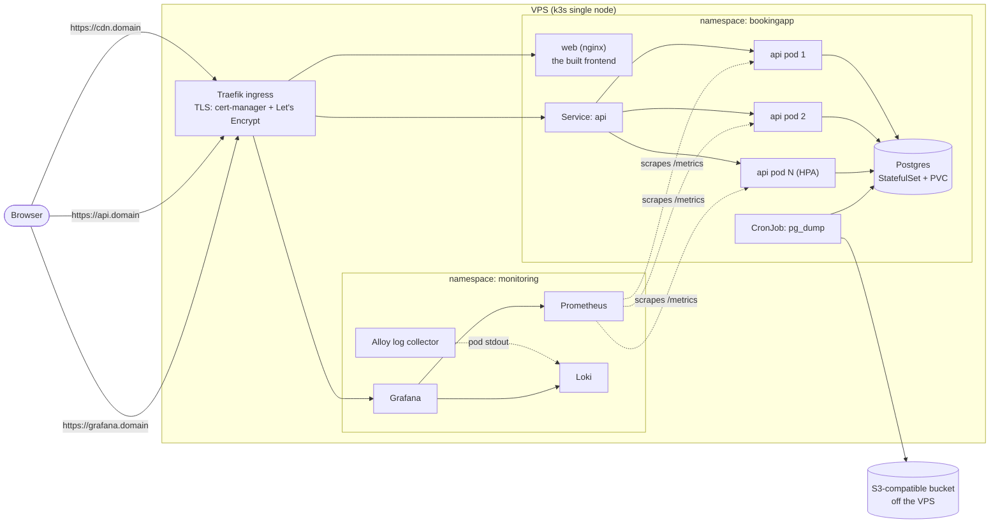
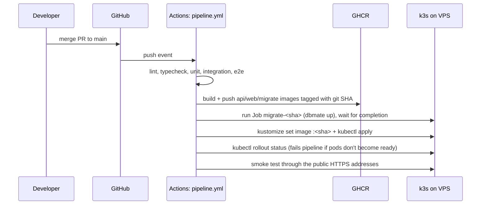

# Architecture

This document defines how the booking app is built and run. It is the reference for implementation
and for the oral defense. If code and this document disagree, fix one of them in the same PR.

Target grade: **VG**. Scope is exactly the G and VG requirements, and nothing beyond them.

`<domain>` = our domain (to be decided, see [ROADMAP.md](ROADMAP.md#open-decisions)).

---

## 1. The product

A single-resource booking app (for example one room or one service provider). A visitor:

1. picks a date and sees the free time slots,
2. books a slot by entering their name.

Bookings are final. There is no cancelling and there are no user accounts (§13).

### Booking rules

| Rule | Value |
|---|---|
| Time zone | All times are local `Europe/Stockholm` |
| Bookable days | Monday–Friday |
| Opening hours | 09:00–17:00 |
| Slot length | 60 minutes, starting on the hour (09:00 … 16:00 = 8 slots/day) |
| Booking window | Today up to 30 days ahead, never in the past |
| Capacity | One booking per slot |

Rules live in one module in the backend (`backend/src/domain/slots.ts`) so they are unit-testable
and can be changed in one place.

---

## 2. System overview

Everything runs on **one VPS** running **k3s** (lightweight Kubernetes).



### Hostnames

| Host | Serves | Cache policy |
|---|---|---|
| `cdn.<domain>` | The whole frontend: `index.html` + JS/CSS/images (content-hashed file names) | `index.html`: `no-cache` · `/assets/*`: `public, max-age=31536000, immutable` |
| `<domain>` | Permanent redirect (301) to `https://cdn.<domain>/` | – |
| `api.<domain>` | REST API | none |
| `grafana.<domain>` | Grafana dashboards (login required) | none |

All are HTTPS with Let's Encrypt certificates issued by cert-manager. HTTP redirects to HTTPS.

**Why the whole frontend is on `cdn.`:** the page and its assets share an origin, so no CORS header and
no separate CDN build setting are needed. It still meets "static files are served over
`cdn.<domain>`". There are two cache rules because a long-cached `index.html` would keep users on an
old release after a deploy. Hashed assets can be cached forever. Both rules sit in the one nginx
`server` block for `cdn.`.

### How a request reaches the database

1. The browser opens `https://<domain>/`, gets redirected to `https://cdn.<domain>/`, and loads
   `index.html` plus `/assets/index-<hash>.js` from the same host.
2. The SPA calls `POST https://api.<domain>/bookings`. DNS resolves to the VPS IP.
3. **Traefik** (k3s's built-in ingress, on ports 80/443) terminates TLS. It matches the `api.<domain>`
   Ingress rule and load-balances round-robin across the **ready** endpoints of the `api` Service.
   Pods that are not ready get no traffic.
4. **Fastify** in the chosen pod checks CORS (only `https://cdn.<domain>` is allowed), validates the body
   against a JSON schema (400 on failure), then runs controller → service (business rules) →
   repository (SQL).
5. The repository runs a single `INSERT` against **Postgres** through `Bun.sql`'s connection pool.
   The unique constraint decides who wins a race for the same slot (see §5).
6. The response goes back the same way. Fastify logs one JSON line per request, Alloy ships it to Loki,
   and the request is counted in the `http_request_duration_seconds` histogram that Prometheus scrapes.

---

## 3. Components

### Frontend: `frontend/`
- React 19 + TypeScript + Vite (already set up).
- Talks to the API through one small client module (`src/api.ts`) using `VITE_API_URL`.
- Production image: multi-stage. Node builds with `VITE_API_URL=https://api.<domain>` (Vite's default
  `base: '/'`), then **nginx** serves `dist/` on `cdn.<domain>` and answers `<domain>` with the 301.

### Backend: `backend/`
- **Bun** runtime + **Fastify 5** + TypeScript. Layering already started on the backend branch:
  `http/routes → http/controllers → services → repository`.
- `src/app.ts` exports `buildApp()` (registers plugins and routes, no `listen`). `src/index.ts` only
  calls `buildApp().listen(...)`. This split lets integration tests use `app.inject()` without a port.
- `src/config.ts` reads and validates env vars at startup and fails fast if they are missing.
- Listens on `0.0.0.0` in containers. The current default is `localhost`, which is unreachable from
  outside the pod.
- Plugins: `@fastify/cors` (exactly one allowed origin, from `CORS_ORIGIN`: `https://cdn.<domain>` in
  production, `http://localhost:5173` for Vite dev, `http://localhost:8080` in compose/e2e), a metrics plugin
  (`fastify-metrics`/`prom-client`).
- Logging: Fastify's built-in pino logger, JSON to stdout, with a request id on every line. Booker names
  are **not** logged.
- Production image: `oven/bun` base, runs as a non-root user, `bun install --production`, no dev deps.

### Database
- **PostgreSQL 16** (same as the local `docker-compose.yml`), single instance as a k8s StatefulSet with
  a persistent volume (k3s `local-path`). Only reachable inside the cluster, never exposed publicly.
- Migrations with **dbmate** (`backend/db/migrations/`). They are forward-only: once a migration is merged
  to `main` it is never edited, and changes go in a new file.

---

## 4. API contract

Base URL: `https://api.<domain>`. JSON in and out. Errors always use this shape:

```json
{ "error": { "code": "SLOT_TAKEN", "message": "Slot is already booked" } }
```

| Method & path | Purpose | Success | Errors |
|---|---|---|---|
| `GET /available-slots?date=YYYY-MM-DD` | Slots for a day with availability | `200 { date, slots: [{ startTime: "09:00", available: true }] }` | `400` bad/out-of-window date |
| `GET /bookings` | Booked slots (already built on the backend branch; names removed) | `200 { bookings: [{ id, date, startTime }] }` | – |
| `POST /bookings` | Create a booking. Body `{ name, date, startTime }` | `201 { booking: { id, name, date, startTime } }` | `400` validation / rule violation, `409 SLOT_TAKEN` |
| `GET /health/ready` | Readiness: can serve traffic (`SELECT 1` succeeds, not shutting down) | `200 { status: "ok", version: "<git sha>" }` | `503` |
| `GET /version` | The git SHA the pod was built from (passed in as `APP_VERSION` at image build) | `200 { version: "<git sha>" }` | – |
| `GET /metrics` | Prometheus metrics, scraped in-cluster | `200` text | – |

`GET /bookings` drops the `name` field compared with the current branch. Names are personal data and
the API is public.

---

## 5. Data model and the double-booking guarantee

The first migration (`20261027084500_create_bookings.sql`) is still on the unmerged
`feature/booking-database` branch and has never been deployed. The forward-only rule (§3) applies only
after a migration reaches `main`, so the two constraints are **folded into that first migration before
the branch is merged**:

```sql
-- migrate:up
create table bookings (
    id          bigserial primary key,
    name        text not null check (char_length(name) between 1 and 100),
    date        date not null,
    start_time  time not null,
    created_at  timestamptz not null default now(),
    constraint bookings_slot_unique unique (date, start_time)
);

-- migrate:down
drop table bookings;
```

The columns are identical to the branch's version. Only the name `check` and the `unique` constraint
are new. Anyone who already ran the old version locally resets their dev DB once
(`dbmate drop && dbmate up`). From then on, every schema change is a new migration that follows the
expand/contract rule (§6).

**How double booking is prevented:** the service does *not* do "check if free, then insert". That
pattern is a race condition, and with ≥2 API pods it is guaranteed to fail under load, because two pods
can both see the slot as free. The service just `INSERT`s. Postgres enforces `unique (date, start_time)`
atomically, and the repository maps error `23505` (unique_violation) to `409 SLOT_TAKEN`. An
integration test fires N concurrent `POST`s for the same slot and asserts exactly one `201` and N-1 `409`s.

Business rules the DB can't express (weekday, opening hours, on-the-hour, not in the past, ≤30 days)
are checked in the service layer and unit-tested.

---

## 6. Runtime platform (k3s)

Why k3s and not docker compose on the VPS: compose can't do rolling updates, health-gated traffic or
autoscaling, and all three are VG requirements. k3s is a single binary with Traefik, a service load
balancer, local-path storage and metrics-server built in. We use it from the first deploy so we only
build the deploy pipeline once. Compose is used **only for local development and CI e2e**.

Manifests live in `deploy/k8s/` as plain YAML plus Kustomize (to set the image tag). Cluster add-ons
(cert-manager, kube-prometheus-stack, Loki, Alloy) are installed once with Helm, and their values files
are committed under `cluster/` so the setup is reproducible.

| Object | Key settings |
|---|---|
| `Deployment api` | Readiness probe on `/health/ready` (from the first deploy). From VG: `replicas: 2` (then the HPA owns it), CPU request `100m` / limit `500m`, memory request `128Mi` / limit `256Mi`, `preStop` using the built-in `sleep` action (5s), `terminationGracePeriodSeconds: 30` |
| `Service api` | ClusterIP, port 3000 |
| `HorizontalPodAutoscaler api` | min 2, max 6, target 60% CPU, scale-down stabilization 60s (short so it can be shown in the demo) |
| `Deployment web` | nginx, 2 replicas |
| `StatefulSet postgres` | 1 replica, 5Gi PVC, credentials from a `Secret` |
| `Job migrate-<sha>` | `dbmate --wait up`, run by the pipeline before each rollout. `backoffLimit: 0`, `ttlSecondsAfterFinished: 3600`. The pipeline deletes any existing Job with the same name first, so redeploying the same commit works |
| `CronJob db-backup` | daily, see §9 |
| `Ingress` ×3 | `cdn.` + `<domain>` → web, `api.` → api, `grafana.` → Grafana |

**Connection budget:** max 6 pods × pool size 10 = 60 connections, which is below Postgres's default
`max_connections = 100`. The official `postgres:16` image doesn't change that default, but we confirm
it with `SHOW max_connections;` on the deployed instance.

### Zero-downtime deploys (VG)

A new version rolls out with no failed requests because of these five pieces working together:

1. **Rolling update** with `maxUnavailable: 0, maxSurge: 1`: a new pod must be ready before an old one is removed.
2. **Readiness probe** on `/health/ready`, so Traefik only sends traffic to pods that can reach the DB.
3. **`preStop` sleep of 5s**: when a pod is told to stop, endpoint removal takes a moment to reach Traefik.
   The pod keeps serving during that window instead of refusing connections. We use Kubernetes' built-in
   `lifecycle.preStop.sleep` action (on by default since k8s 1.30) rather than `exec: sleep`, so it works
   even if the image has no `sleep` binary.
4. **Graceful shutdown in the app**: on `SIGTERM`, readiness flips to 503, `fastify.close()` finishes
   in-flight requests, then the DB pool closes, all within the 30s grace period.
5. **Backward-compatible migrations** (expand/contract): migrations run *before* the rollout while old
   pods are still serving, so every migration must work with both the old and the new code. Example:
   add a nullable column now and drop the old one in a later release.

**Proof:** a k6 script (`performance/`) runs constant load while we merge a change. The k6 threshold
`http_req_failed == 0` must pass, and Grafana shows the pods being replaced.

### Autoscaling (VG)

HPA on CPU via k3s's built-in metrics-server. Bun runs one event loop per process, so scaling out
pods is the natural way to use more cores. **Proof:** a k6 ramp drives CPU over target. In Grafana
(replica count from kube-state-metrics) and `kubectl get hpa -w`, replicas go 2 → N, then back to 2
after the load stops.

Making sure it actually triggers:
- **Utilization is measured against the CPU request**, not against a whole core. With a `100m` request,
  60% means 60 millicores per pod. Even endpoints that mostly wait on Postgres (JSON parsing,
  validation, logging, building responses) get there under moderate load. The ramp mainly hits
  `GET /available-slots`, which computes the day's slots in the API on every call.
- **It fits on one node:** 6 pods × `100m` = 600m of CPU requests, plus web, Postgres and monitoring,
  is well under a 4-vCPU VPS. No pod should be stuck in `Pending` at max scale. The rehearsal checks this.
- **k6 runs from a laptop, never on the VPS.** Otherwise the load generator competes with the API for
  the same CPU and the results are meaningless.
- If CPU-based scaling still doesn't trigger in the rehearsal, the fallback is to lower the target
  (e.g. 40%).

---

## 7. CI/CD: from merge to deploy

GitHub Actions, **one workflow** (`.github/workflows/pipeline.yml`):

- **On every pull request:** lint + typecheck → unit → integration (Postgres service container) → e2e
  (Playwright against the compose stack). Must pass before merge (branch protection: PR, green checks,
  one approval).
- **On every push to `main`** (every merge): the same tests, then a `deploy` job that runs only if they
  pass. `concurrency: production` makes sure only one deploy runs at a time.



- **A failed migration stops the deploy.** The Job has `backoffLimit: 0`. The pipeline waits for either
  `condition=complete` or `condition=failed`, prints the Job's logs, and exits non-zero on failure. The
  rollout never starts, so the old pods keep serving the old schema.
- **Smoke test against production:** after the rollout, the pipeline checks that
  `https://api.<domain>/version` returns the SHA just deployed and that `https://cdn.<domain>/` returns
  HTML. Either failure fails the run, and the runbook says to roll back.
- Images are tagged with the commit SHA, never `latest`, so every running pod maps to an exact commit
  and rollback is precise.
- The pipeline reaches the cluster over SSH (deploy key in GitHub Secrets) and runs `kubectl` on the
  VPS. This keeps the k8s API port (6443) closed to the internet.
- **Rollback:** `git revert` + merge (the normal path, fully traceable), or
  `kubectl rollout undo deployment/api` in an emergency.

---

## 8. Testing strategy

| Level | Tool | What | Runs |
|---|---|---|---|
| Unit | `bun test` | Slot rules (weekends, hours, on-the-hour, past, window), validation, error mapping. Repository mocked | PR + main |
| Integration | `bun test` + real Postgres | Through `app.inject()`: each endpoint's success and error codes, and **concurrent double booking → exactly one 201** | PR + main |
| E2E | Playwright | Full stack via compose: pick a date, book a slot, and the slot shows as taken | PR + main |
| Smoke | curl | `/version` SHA + frontend HTML on the production addresses (§7) | main, after deploy |
| Load | k6 | Zero-downtime and autoscaling demonstrations | manually, for the VG demo |

Integration tests truncate tables between tests. They never run against the production DB.

---

## 9. Operations

### Metrics and logs
- **Prometheus** (kube-prometheus-stack, trimmed: no Alertmanager, short retention) scrapes API pods,
  nodes and kube-state-metrics. Its built-in dashboards already cover pod/node CPU, memory and disk.
- **Loki** + **Alloy** collect stdout from every pod.
- **Grafana** at `grafana.<domain>` (admin password in a Secret) with one committed dashboard
  (`cluster/grafana/bookingapp.json`) with five panels:
  request rate, error rate (5xx), p95 latency, API replica count, and a logs panel (Loki).

### Backups
- `CronJob db-backup` runs daily at 03:00 Europe/Stockholm: `pg_dump -Fc`, then uploads to an
  **S3-compatible bucket outside the VPS**. A backup on the same disk doesn't survive losing the VPS.
- The bucket is in an **EU region**, because dumps contain booker names (personal data under GDPR).
  The bucket is private, and the backup credentials can only write to that one bucket.
- The backup script runs with `set -euo pipefail`, so a failed `pg_dump` **or** a failed upload marks
  the Job as failed (visible in `kubectl get jobs`) instead of looking like a success.
- Retention: 14 days, set as a bucket lifecycle rule.
- **A backup isn't trusted until a restore has been tested.** The restore procedure is in
  `docs/RUNBOOK.md` and is rehearsed once into a scratch database before the defense.

### When something goes wrong
`docs/RUNBOOK.md` has four entries: a bad deploy (roll back), a crash-looping pod, the DB is down, and
restoring from backup. Each has the Grafana panel or log query to check and the exact commands to run.

---

## 10. Configuration and secrets

| Where | What |
|---|---|
| `.env.example` files (committed) | Every variable, with dummy values |
| GitHub Secrets | SSH deploy key, VPS host. GHCR uses the built-in `GITHUB_TOKEN` |
| k8s `Secret`s (created on the cluster by hand, documented, **never committed**) | `DATABASE_URL`, Postgres password, S3 credentials, Grafana admin password, `ghcr-pull` |

**Pulling images from GHCR:** images pushed from Actions are private by default, and k3s can't pull
them anonymously. We use an `imagePullSecret` instead of making the packages public, because it works
the same whether the repo is public or private. `ghcr-pull` is a `docker-registry` Secret holding a
classic PAT with **only** the `read:packages` scope, with an expiry past the grading date. It's
referenced from the namespace's default ServiceAccount, so every pod (api, web, migrate) can use it
without per-manifest config.

Backend env: `PORT`, `HOST`, `DATABASE_URL`, `CORS_ORIGIN` (`https://cdn.<domain>`), `LOG_LEVEL`,
`APP_VERSION` (set at image build).
Frontend build-time env: `VITE_API_URL`.

---

## 11. Repository layout (target)

```
.
├── ARCHITECTURE.md / ROADMAP.md / README.md
├── docker-compose.yml          # local dev + CI e2e
├── backend/
│   ├── src/{app.ts,index.ts,config.ts,domain/,http/,services.ts,repository/}
│   ├── db/migrations/
│   ├── tests/{unit,integration}/
│   └── Dockerfile
├── frontend/
│   ├── src/  nginx.conf  Dockerfile
├── e2e/                        # Playwright
├── performance/                # k6 scripts
├── deploy/k8s/                 # app manifests + kustomization.yaml
├── cluster/                    # Helm values, Grafana dashboard, VPS bootstrap notes
├── docs/RUNBOOK.md
└── .github/workflows/pipeline.yml
```

---

## 12. Decisions

| Decision | Chosen | Rejected alternatives and why |
|---|---|---|
| Orchestration | k3s on one node | Docker compose: no rolling updates/HPA, so it can't reach VG. Managed k8s: the exam requires our own VPS |
| Double-booking protection | DB unique constraint | Check-then-insert: race condition across pods. App-level locks: don't work across pods |
| Static hosting | Whole frontend on `cdn.<domain>`, `<domain>` redirects there | Page on `<domain>` + assets on `cdn.`: needs a CORS header and a CDN build setting for the same requirement. External CDN: another provider |
| Deploy access | SSH from Actions → `kubectl` on the VPS | Exposing port 6443 to GitHub's IP ranges: larger attack surface |
| Image tags | Git SHA | `latest`: can't tell what's running, and rollback is ambiguous |
| Observability | Self-hosted kube-prometheus-stack + Loki + Grafana | Grafana Cloud: less load on the VPS, but the exam says everything runs on our VPS. **Asked the teacher:** if an external service is allowed, we switch, and a 4 GB VPS is enough |
| Runtime | Bun + Fastify (existing choice) | Kept to avoid churn. The metrics library is checked on Bun first thing (ROADMAP G5) |

## 13. Known limitations (stated openly at the defense)

- **One node:** two pods give us rolling deploys and spread load across CPU cores, but if the VPS goes
  down, everything goes down. Real HA would need ≥3 nodes and replicated Postgres, which is out of scope.
  We have asked the teacher to confirm that one node is acceptable for VG.
- **Single Postgres instance:** recovery from losing the volume = restore the latest daily backup
  (RPO ≤ 24h).
- **No liveness probe:** a crashed process is restarted by Kubernetes anyway. A hung but running process
  is taken out of traffic by the readiness probe, but isn't restarted automatically.
- **No PodDisruptionBudget:** it only matters for node drains, and one node is never drained during normal operation.
- **`/metrics` is publicly reachable** at `api.<domain>/metrics`. It holds only request counters and
  timings, no personal data.
- **Out of scope:** cancelling bookings, user accounts/login, admin UI, email confirmations, rate limiting,
  multiple resources, payments.
